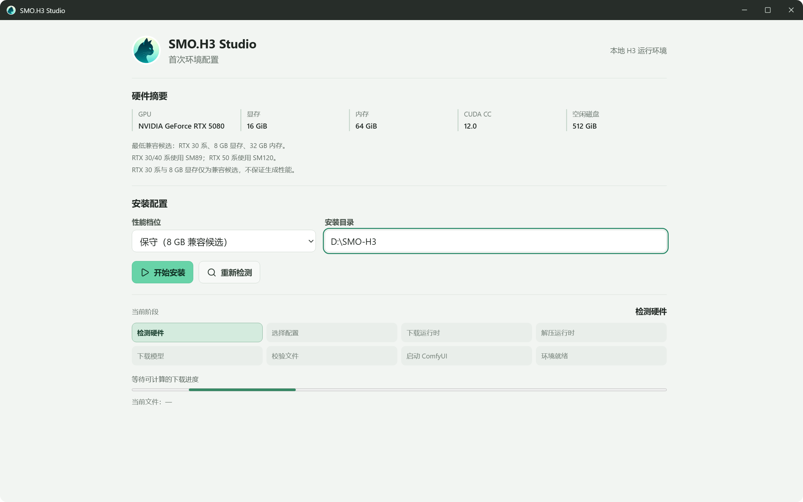
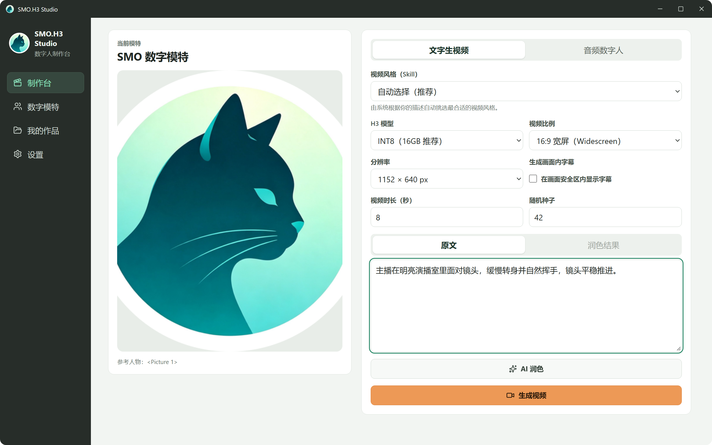
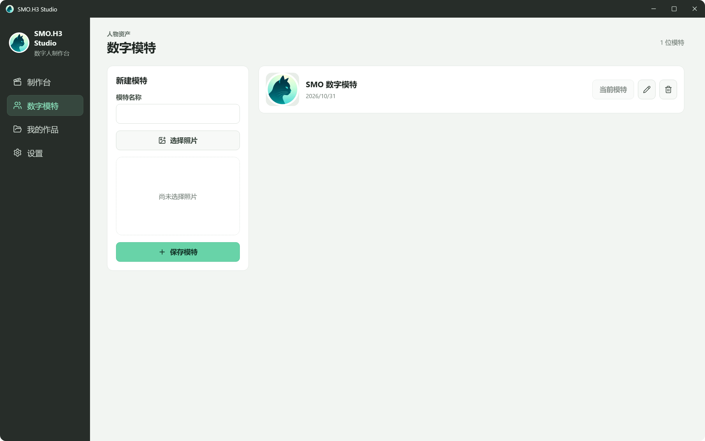
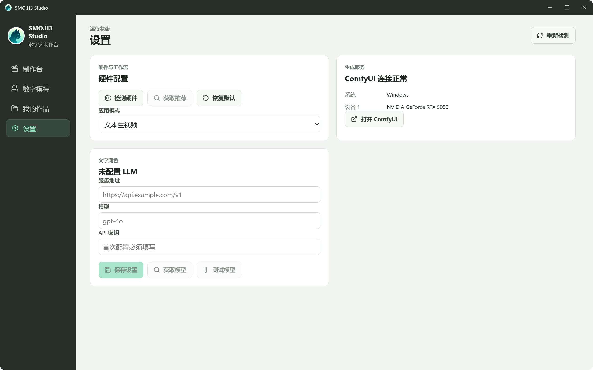

<p align="center">
  
</p>

<h1 align="center">SMO.H3 Studio</h1>

<p align="center">
  基于 ComfyUI 与 MiniMax H3 的 Windows 数字人视频制作台。<br />
  文字 / 音频生成数字人视频，首次启动自动检测硬件并配置本地运行环境。
</p>

<p align="center">
  <a href="https://github.com/arronfan23/SMO-H3-Studio/releases/latest"></a>
  <a href="./LICENSE"></a>
  
  <a href="https://github.com/arronfan23/SMO-H3-Runtime/releases/tag/runtime-v1"></a>
</p>

---

## 界面预览

| 首次环境配置 | 制作台 |
| --- | --- |
|  |  |

| 数字模特 | 设置 |
| --- | --- |
|  |  |

## 功能特性

- **文字生视频**：文字描述 + 参考图，使用 MiniMax H3 Ref2VA 工作流生成数字人视频。
- **音频数字人**：上传旁白音频生成对口型视频；不填时长时按音频内容自动确定。
- **AI 提示词润色**：可外接任意 OpenAI 兼容接口（支持获取模型列表与连通性测试），按 H3 官方 Prompt Skill 润色提示词。
- **数字模特管理**：照片预览、重命名、删除，作品与模特关联管理。
- **首次启动自动配置**：自动检测 GPU、显存、内存与磁盘空间，按硬件选择 SM89 / SM120 运行包并自动下载模型。
- **可靠的下载与安装**：断点续传、SHA256 校验、原子写入、失败可恢复，不静默混用损坏文件。
- **真实生成进度**：队列位置、采样帧进度与阶段状态实时可见，支持取消与失败重试。

## 硬件要求

| 档位 | GPU | 显存 | 内存 | 运行包 |
| --- | --- | --- | --- | --- |
| 最低候选 | NVIDIA RTX 30 系 | 8 GB | 32 GB | SM89 |
| 推荐 | NVIDIA RTX 40 系 | 12–19 GB | 32 GB | SM89 |
| 已实测 | NVIDIA RTX 5080 | 16 GB | 64 GB | SM120 |

> RTX 30 系、8 GB 显存与 BF16 路径为未实测的兼容候选，不保证生成性能与稳定性。

## 下载与安装

1. 从 [Releases](https://github.com/arronfan23/SMO-H3-Studio/releases/latest) 下载 `SMO.H3-Studio-<版本>.exe`（Windows portable，无需安装）。
2. 首次打开会自动检测硬件，并进入环境配置向导。
3. 确认性能档位与安装目录后开始安装。运行环境从 [SMO-H3-Runtime](https://github.com/arronfan23/SMO-H3-Runtime/releases/tag/runtime-v1) 下载，模型文件由各发布方原始链接提供并逐一校验。
4. 安装完成后自动进入制作台。

首次安装需要下载运行包与模型文件，请保持网络畅通并预留充足磁盘空间。安装中断后可继续，已校验的文件不会重复下载。

## 本地开发

```bash
npm install
npm run dev        # 开发模式
npm test           # 单元测试
npm run test:e2e   # 端到端测试（模拟后端）
npm run pack       # 构建 Windows portable
```

刷新 README 截图：

```bash
npm run build
$env:SMO_CAPTURE_SCREENSHOTS = '1'
npx playwright test tests/e2e/screenshots.spec.ts
```

## 运行环境与模型来源

- 运行包分块与清单：[SMO-H3-Runtime](https://github.com/arronfan23/SMO-H3-Runtime)
- 模型文件不上传到本仓库，安装时从 Hugging Face 各发布方原始地址下载并校验大小与 SHA256，详见 [第三方声明](https://github.com/arronfan23/SMO-H3-Runtime/blob/main/THIRD_PARTY_NOTICES.md)。

## 技术栈

Electron · React · TypeScript · Node:sqlite · ComfyUI HTTP/WebSocket · Vitest · Playwright · electron-builder

## 许可证

[MIT](./LICENSE)

本软件不是 MiniMax 官方产品。ComfyUI、MiniMax H3、SelfLift 及相关模型与节点均保留其原有许可证与权利归属。
